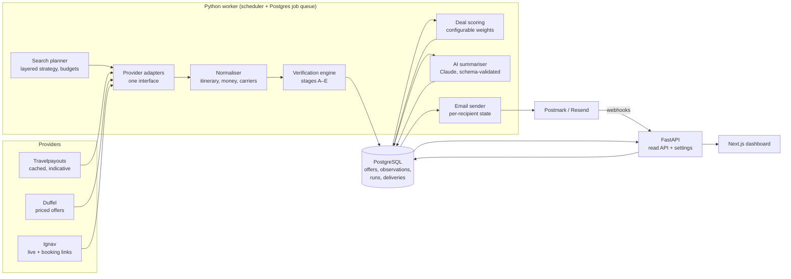

# Sydney Flight Intelligence — Phase 1: provider feasibility and architecture

Status: **Phase 1 report, 2026-10-19.** The gate before application development.
No live search has been run yet: every provider below needs an account and API key from the owner
(see section 7). Nothing in this document is a fare.

---

## 1. Summary

- **Primary source: Duffel Flights API (live mode).** It is a documented, self-serve shopping API
  that returns priced, expiring offers with per-segment marketing **and** operating carriers,
  cabin, fare brand, baggage and taxes-inclusive totals. Duffel's own airline pages say that
  **China Southern** and **Virgin Australia** content is reached through Travelport (GDS), alongside
  NDC content from carriers such as Qantas. It can re-fetch a single offer to confirm the price
  before publishing (verification stage C).
- **Second, independent source: Ignav (live metasearch API).** Self-serve, US$2 per 1,000
  successful requests (first 1,000 free), and it returns **booking links** per itinerary, which
  Duffel cannot give us as a non-selling user. Used for corroboration (stage D) and the
  "View fare" link (stage E). Its underlying data sources and terms must be checked before live
  use — see risk R3.
- **Exploration only (never recommended to buy): Travelpayouts / Aviasales Data API.** Free,
  cached prices that users found in the last 2–7 days, with an `expires_at`. Useful to find cheap
  months (layer 1 of the search strategy) and always stored as **Indicative**.
- **Not viable for us today:** Amadeus Self-Service (portal shut down 17 July 2026; flight search now
  needs an Amadeus Enterprise contract), Kiwi Tequila (partner-only since 2024), Skyscanner Travel
  API (approved high-volume partners only), Sabre / Travelport direct (agency contract, PCC and
  certification), scraping Google Flights or OTAs (terms of use).
- **Conclusion:** a viable source exists, so Phase 2 can start **once the owner opens a Duffel
  account with live access** (and an Ignav key for corroboration). The first milestone — one real,
  currently priced SYD return itinerary with dates, operating carrier, total A$ and a booking
  path — is ready to run with `flight-intel/probe/live_search.py` as soon as a key exists.

---

## 2. Provider comparison

Scale: ✅ good · ⚠️ partial / to confirm · ❌ not available.

| Criterion | Duffel (live) | Ignav | Travelpayouts Data API | Amadeus | Skyscanner / Kiwi | Sabre / Travelport direct |
|---|---|---|---|---|---|---|
| Access for an individual | ✅ self-serve; live mode needs company verification | ✅ self-serve key | ✅ free token | ❌ Enterprise contract only since 17 Jul 2026 | ❌ partner approval | ❌ agency contract |
| Current, bookable price | ✅ priced offer with `expires_at` | ⚠️ live search, but provider can't hold the price | ❌ cached 2–7 days | (✅ under Enterprise) | — | ✅ |
| Australian market / AUD | ✅ AU carriers named (Qantas NDC, Virgin via GDS); currency to confirm | ⚠️ to test with SYD | ✅ `currency=aud` | — | — | ✅ |
| China Southern | ✅ via Travelport (Duffel airline page) | ⚠️ to test | ⚠️ whatever users searched | — | — | ✅ |
| Virgin Australia + partners | ✅ via Travelport; partner-operated segments shown by operating carrier | ⚠️ to test | ⚠️ | — | — | ✅ |
| Low-cost carriers (Jetstar, Scoot, AirAsia X…) | ⚠️ some (Jetstar page exists); confirm Scoot | ✅ typical of metasearch | ✅ | — | — | ⚠️ |
| Long range (≈ 330–360 days) | ✅ as far as airline schedules are loaded | ⚠️ to test | ⚠️ sparse far out | — | — | ✅ |
| Return fare pricing | ✅ multi-slice offer priced as one | ✅ round-trip search | ⚠️ | — | — | ✅ |
| Cabin, fare brand, booking class | ✅ cabin + fare brand; RBD not always exposed | ⚠️ cabin | ❌ | — | — | ✅ |
| Taxes & mandatory fees in total | ✅ `total_amount` incl. taxes | ⚠️ to confirm | ⚠️ | — | — | ✅ |
| Baggage | ✅ per segment/passenger | ⚠️ | ❌ | — | — | ✅ |
| Offer expiry / repricing | ✅ `expires_at`, single-offer fetch | ❌ (re-search only) | ❌ | — | — | ✅ |
| Booking link / deeplink | ❌ for us (Duffel is for sellers who book through it) — we build a search URL instead | ✅ booking-link endpoint per itinerary | ⚠️ Aviasales affiliate link | — | — | ❌ |
| Low-fare calendar | ❌ one date pair per request | ⚠️ to confirm | ✅ month matrix (cached) | — | — | ✅ |
| Cost | US$0.005 per search when we don't book (excess-search fee); no monthly fee | US$2 / 1,000 requests | free | — | — | contract |
| Terms fit for personal monitoring | ⚠️ intended for sellers; the excess-search fee anticipates search-only usage — confirm with Duffel | ⚠️ read terms and data provenance | ⚠️ affiliate programme; cached data must be labelled as such | — | — | — |

**Duffel cost detail** (from Duffel's help centre and third-party pricing listings; confirm on the
pricing page): orders US$3 + 1 % of order value (we will not place orders), paid ancillaries US$2,
**excess search US$0.005 per search beyond 1,500 searches per order**. With zero orders, every
search is excess, so 6,000 searches/month ≈ US$30.

---

## 3. Risks identified before coding

| # | Risk | Effect | Mitigation |
|---|---|---|---|
| R1 | Duffel live-mode access needs a verified business/individual account; approval is Duffel's decision | Blocks milestone 1 | Owner applies now; fallback is Ignav as primary with prices labelled "live search, not held" |
| R2 | Duffel has no calendar endpoint; each offer request is one date pair and can take 10–30 s | Search volume and cost | Layered search (section 5): cheap exploration first, Duffel only on short-listed date pairs; budget cap per day |
| R3 | Ignav's fare sources and redistribution terms are not documented publicly in what we could read | Corroboration source might be unsuitable | Read the terms before use; if unsuitable, corroborate by a second Duffel source (NDC vs GDS of the same carrier) or drop stage D to "not possible" and say so |
| R4 | Booking path: Duffel offers can't be bought by the user outside Duffel | Stage E | Use Ignav's exact itinerary link when it matches; otherwise an airline or Google Flights **search URL** preserving route, dates and cabin, labelled as a search (not the exact fare) |
| R5 | Virgin Australia's Europe product is mainly VA-coded flights **operated by Qatar Airways via Doha** — excluded by the transit rule | VA will often have no qualifying Europe fare | Report "No practical fare found today" honestly; still assess VA via Singapore (partner Singapore Airlines) and Japan/China options, including the China Southern–Virgin codeshare (started April 2026) |
| R6 | Currency: the offer currency follows the account/market, not always AUD | Wrong-currency display | Keep original amount; convert with a dated published rate (RBA daily rates); show "approx. A$" |
| R7 | Loyalty earning needs the booking class (RBD), which GDS/NDC content does not always expose | Overstated Velocity/Sky Pearl claims | Only state earning when RBD + current earning table support it; otherwise "earning depends on fare class — check before booking" |
| R8 | Email to iCloud (me.com) needs a verified sending domain with SPF, DKIM and DMARC | Mail lands in junk or is rejected | Owner needs a domain they control (section 7) |
| R9 | Transit restriction must cover technical stops and codeshares | A Doha/Dubai/Istanbul stop slipping through | Check every segment's endpoints **and** Duffel's `stops` list against the excluded country list, by airport country — not by airline |

**Excluded transit countries (default):** United Arab Emirates, Qatar, Bahrain, Saudi Arabia, Oman,
Kuwait, Jordan, Lebanon, Israel, Iran, Iraq, Syria, Yemen, Türkiye, **and Egypt** (often counted as
Middle East; owner to confirm, see section 7). Cyprus and the Caucasus are not excluded by default.

---

## 4. Recommended architecture



- **Backend:** Python 3.12, FastAPI for the read/settings API; a separate **worker** process runs
  the schedule. Python because the verification rules, scoring and tests are easiest to keep
  readable there; the frontend never sees provider keys.
- **Jobs:** PostgreSQL-backed queue (e.g. `procrastinate`) with per-job idempotency keys
  (`run_date + destination + layer`), retries with exponential backoff for transient errors only,
  and a per-provider token-bucket rate limiter. No Redis needed.
- **Database:** PostgreSQL. Core tables: `provider_call` (every request, status, latency, error),
  `search_run`, `offer` (one priced observation; original currency + A$; expiry; verification
  state; booking URL kind), `segment`, `itinerary_key` (a stable hash of carriers + flight numbers +
  dates + cabin, so price changes compare like with like), `score`, `report`, `email_delivery`
  (per recipient: queued / accepted / delivered / bounced / failed, provider message id).
- **Provider abstraction:** `search(slices, cabin, pax) -> list[NormalisedOffer]`,
  `reprice(offer_ref) -> NormalisedOffer | Expired`, `booking_link(offer) -> Link | None`, plus a
  `capabilities` record (can_reprice, has_booking_links, is_cached) that the verification engine
  reads instead of assuming.
- **AI layer:** Claude via the Anthropic API, given only rows from the database, returning JSON
  validated against a schema (explanations, best-three, overall verdict). If validation fails the
  report is sent without the AI text, never with invented content.
- **Email:** Postmark (deliverability, clear bounce/delivery webhooks, message streams) or Resend
  (simpler, good free tier). Two separate sends, `Agent: Best flights - <date in Australia/Sydney>`.
- **Hosting:** one small container host (Fly.io, Render or a A$10 VPS) running API + worker +
  dashboard, managed Postgres (Neon / Supabase / Render). Docker Compose for local development.

---

## 5. Search strategy and call budget

| Layer | Source | What | Daily volume (est.) |
|---|---|---|---|
| 1. Explore | Travelpayouts (free, cached) | Month/week price matrix SYD → each destination, next 12 months | ~40 calls |
| 2. Short-list | planner | Pick the cheapest 3–5 departure windows per destination and trip-length band | — |
| 3. Price | Duffel | Return offers for chosen date pairs, economy; premium economy and business on a rotating subset; **mandatory China Southern and Virgin Australia searches** (filtered by carrier) | ~150–250 searches |
| 4. Reprice | Duffel single-offer fetch | Top candidates just before the report | ~20 |
| 5. Corroborate + link | Ignav | Same itinerary, for a second price and a booking link | ~40 |

About 6,000–8,000 Duffel searches a month (≈ US$30–40) and 1,500 Ignav requests (≈ US$1–3).
Budgets are hard caps in configuration; when a cap is hit the report says which destinations were
not covered.

---

## 6. Monthly operating cost estimate

| Item | Low | Typical |
|---|---:|---:|
| Duffel excess searches | US$15 | US$40 |
| Ignav | US$0 | US$3 |
| Travelpayouts | US$0 | US$0 |
| Hosting (app + worker) | US$5 | US$15 |
| Managed PostgreSQL | US$0 | US$20 |
| Email (Postmark 10k plan / Resend free) | US$0 | US$15 |
| Claude API (one digest + a few alerts per day) | US$3 | US$10 |
| **Total** | **≈ US$25 (≈ A$38)** | **≈ US$100 (≈ A$155)** |

(A$ at roughly 0.65 US$; to be re-checked against the RBA rate when billing starts.)

---

## 7. Decisions and accounts needed from the owner

1. **Duffel account with live mode** (duffel.com → sign up → request live access). Needed for
   milestone 1. Please confirm you accept ~US$30–40/month in search fees, and paste the **live
   access token** as an environment secret (`DUFFEL_ACCESS_TOKEN`), never in chat or the repo.
2. **Ignav API key** (`IGNAV_API_KEY`) for corroboration and booking links — after reading its terms.
3. **Travelpayouts token** (`TRAVELPAYOUTS_TOKEN`), free, for exploration.
4. **A sending domain** you control (for SPF/DKIM/DMARC) and the choice of **Postmark or Resend**.
5. **Egypt** in the excluded transit list: yes (default) or no?
6. **Where the code lives:** this repository is PhotoSelect. Recommended: a new repository
   (e.g. `sydney-flight-intel`). Until then, Phase 1 material sits in `flight-intel/` here.
7. **Network for this cloud environment:** the environment's network policy denied `api.duffel.com`
   (proxy answered 403). Add `api.duffel.com`, `ignav.com` and `api.travelpayouts.com` under
   Allowed domains in the environment's Network access settings
   ([steps](https://code.claude.com/docs/en/cloud-environments#network-access)), or run the probe on
   your Mac.

---

## 8. Milestone 1 — how it will be demonstrated

`flight-intel/probe/live_search.py` (standard-library Python, no dependencies):

```
export DUFFEL_ACCESS_TOKEN=duffel_live_...      # live token, kept out of the repo
python3 flight-intel/probe/live_search.py --dest NRT --depart 2027-04-12 --nights 14
```

It sends one real Duffel offer request SYD ⇄ destination, rejects any itinerary touching an
excluded transit country, re-fetches the cheapest remaining offer to confirm price and expiry, and
prints: dates, every segment with marketing and operating carrier, cabin, fare brand, baggage,
total in the offer's currency (A$ shown only when the currency is AUD, otherwise "approx. A$" with
the rate used), the offer expiry, and a Google Flights search URL for the same route, dates and
cabin, labelled as a search link. A `duffel_test_` token is refused, so test-mode fake airlines can
never be presented as a milestone result.

---

## Sources

- Amadeus Self-Service shutdown: [PhocusWire](https://www.phocuswire.com/amadeus-shut-down-self-service-apis-portal-developers), [AirLabs](https://airlabs.co/amadeus-self-service-api-shutdown), [Ignav migration note](https://ignav.com/docs/amadeus-self-service-shutdown)
- Duffel: [airlines list](https://duffel.com/airlines), [China Southern via Travelport](https://duffel.com/flights/airlines/china-southern-airlines), [Virgin Australia](https://duffel.com/flights/airlines/virgin-australia), [Travelport content / AU-NZ](https://duffel.com/blog/duffel-offers-more-choice-in-airlines), [Excess search](https://help.duffel.com/hc/en-gb/articles/4412912264466-What-is-Excess-Search), [accurate price before booking](https://duffel.com/docs/guides/getting-an-accurate-price-before-booking), [pricing listing](https://apis.io/plans/duffel/duffel-plans-pricing/)
- Ignav: [home](https://ignav.com/), [FAQ / pricing](https://ignav.com/docs/faq), [comparisons](https://ignav.com/docs/comparisons)
- Kiwi Tequila partner-only: [Vervotech](https://www.vervotech.com/hub/integrations/tequila-api/), [PHPTRAVELS](https://phptravels.com/es/integrations/kiwi-api-integration)
- Skyscanner Travel API access: [Skyscanner partnerships](https://www.skyscanner.jp/news/partnerships/skyscanner-travel-api), [AltexSoft](https://www.altexsoft.com/techtalks/what-are-the-pros-and-cons-of-integrating-skyscanner-api-for-flight-search/)
- Travelpayouts Data API: [docs](https://support.travelpayouts.com/hc/en-us/articles/203956163), [readthedocs](https://travelpayouts-data-api.readthedocs.io/)
- Virgin Australia / Qatar wet lease via Doha: [Australian Aviation](https://australianaviation.com.au/?p=1414526), [Point Hacks](https://www.pointhacks.com.au/news/interim-approval-virgin-australia-qatar-airways-flights/); China Southern–Virgin codeshare: [AeroRoutes](https://www.aeroroutes.com/eng/260420-czvacodeshare); extra SYD–CAN daily from 30 Mar 2026: [Karryon](https://karryon.com.au/?p=3153982)
- Email pricing comparisons: [Courier SES vs Resend](https://www.courier.com/integrations/compare/amazon-ses-vs-resend), [Sequenzy Postmark alternatives](https://www.sequenzy.com/alternatives/postmark-alternatives)

Most pricing and coverage facts above come from vendor pages or third-party listings and were not
all confirmable from this session; each is re-checked when the account is opened.
